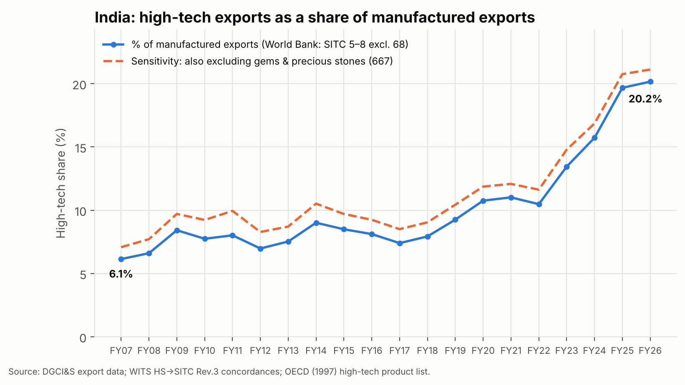
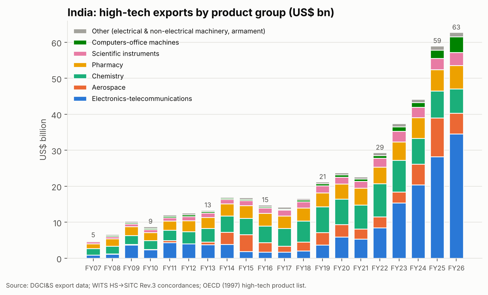
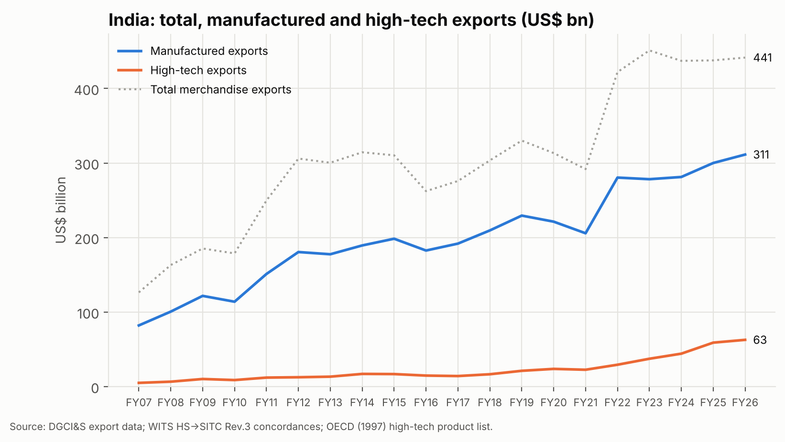
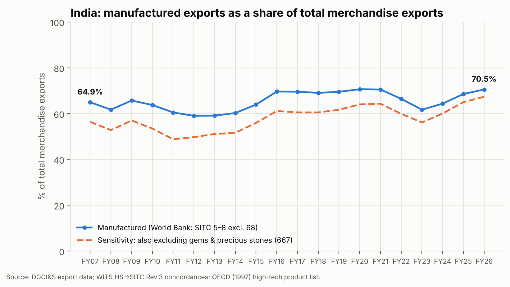
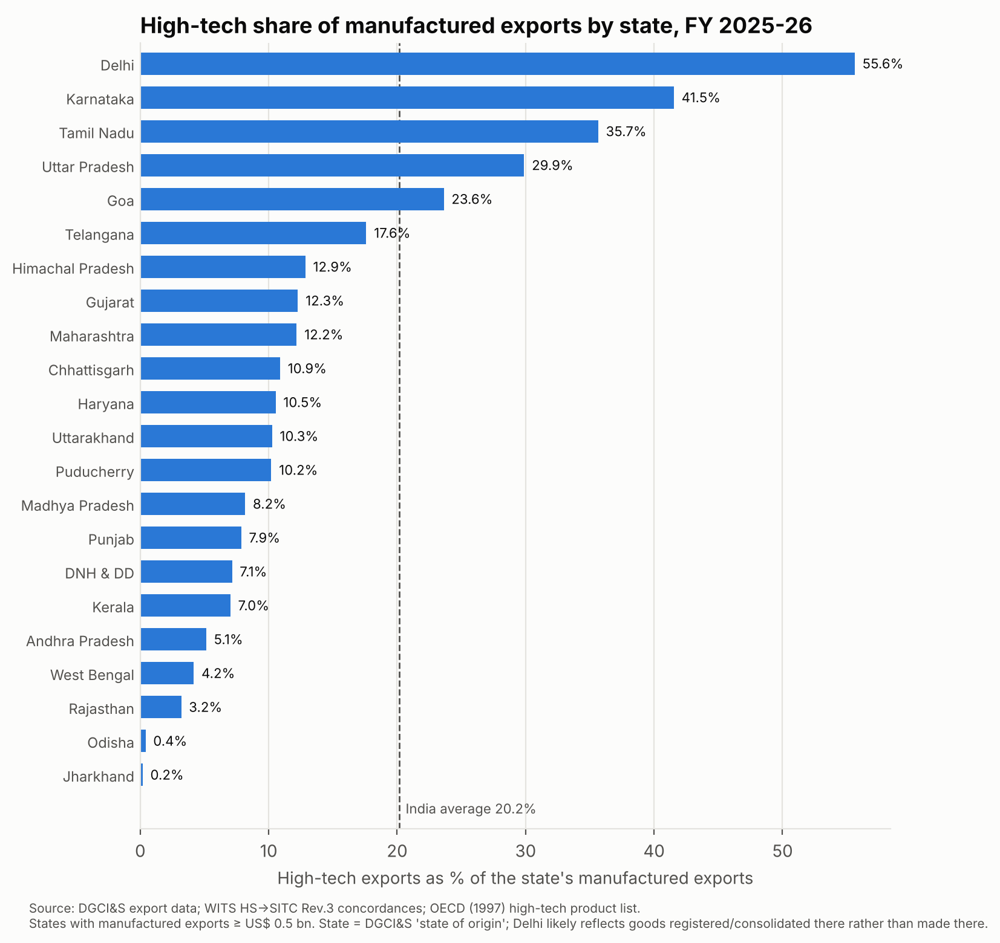
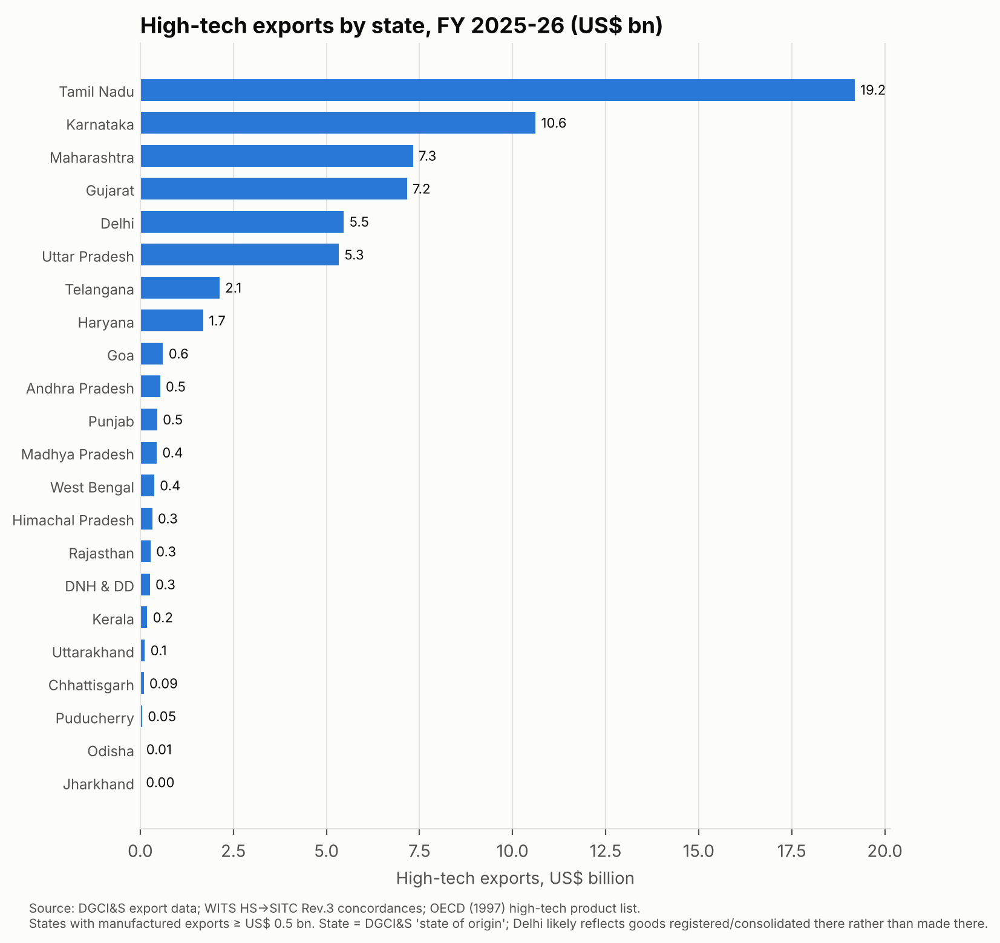
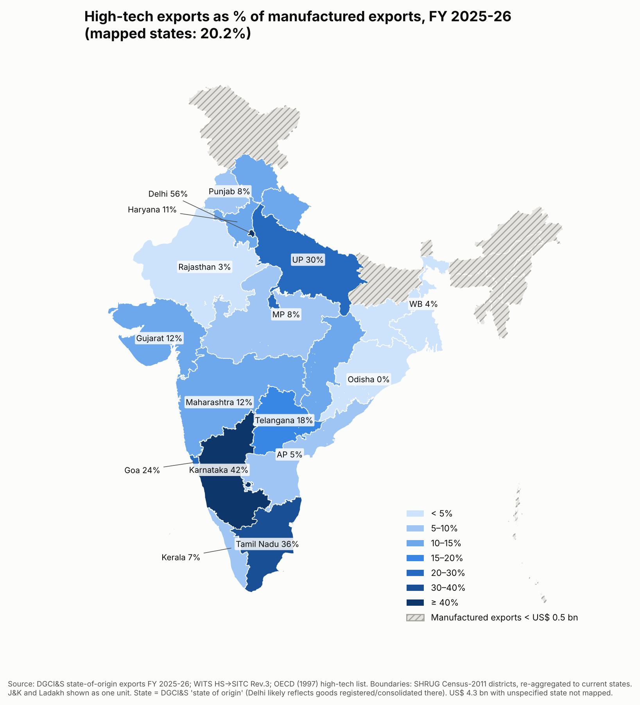
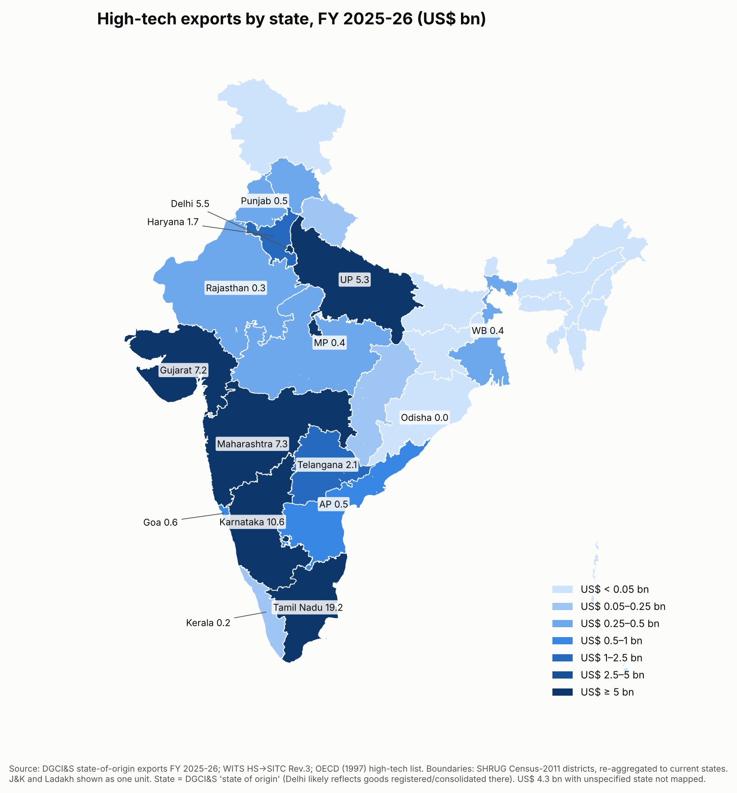
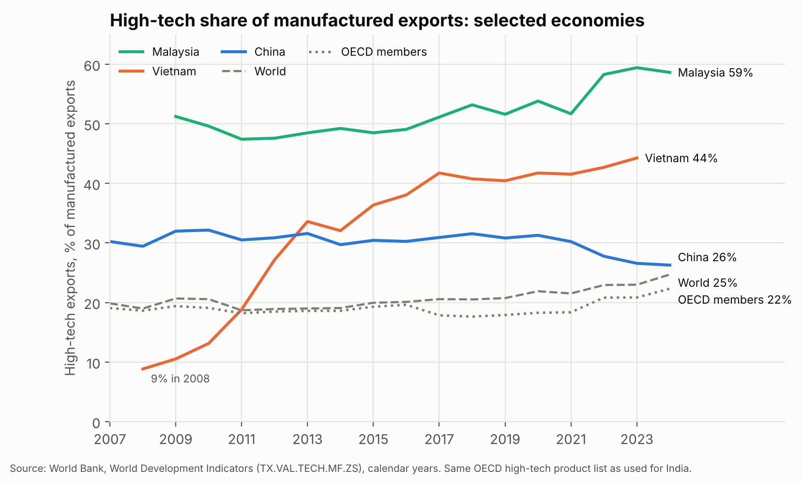

# HighTechExports

**Write-up:** [How Much of What India Makes Is High-Tech?](https://indianwesterlies.substack.com/p/how-much-of-what-india-makes-is-high) (Indian Westerlies, Nov 2026).
Previous post using related data: [Why High-Tech Manufacturing Matters for Growth](https://indianwesterlies.substack.com/p/why-high-tech-manufacturing-matters).

High-tech exports from India: how high-tech goods have evolved as a share of
**manufacturing exports** from FY 2006-07 to FY 2025-26, and how they are spread
across **states and districts** in FY 2025-26.

## Planned approach

1. **Clean the raw DGCI&S data** (HS6-level exports) — *done*.
2. **HS6 → SITC Rev.3** using the WITS concordances, HS edition matched to
   each year — *done (first pass)*.
3. **Flag manufacturing exports** (SITC 5–8 excl. 68; variant also excl. 667)
   and **high-tech exports** (OECD/World Bank SITC Rev.3 list) — *done (first pass)*.
4. **Indicators** — high-tech share of manufacturing exports, nationally by year
   (FY07–FY26) and by state for FY 2025-26 — *done*.
5. **Outputs** — national and state charts and state maps — *done*; district
   analysis and maps — *later*.

## Repository layout

```
data/
  raw/
    yearly_hs6/          DGCI&S yearly HS6 export time series (as downloaded)
    district_2025_26/    DGCI&S "state of origin" State x District x HS6 (zip of 29 .xls)
  processed/             cleaned outputs (produced by scripts/)
  raw/concordances_wits/ WITS HS(2002/07/12/17/22) -> SITC Rev.3 tables
  reference/
    oecd_hightech_sitc3.csv          OECD high-tech product list (SITC Rev.3)
    manual_hs6_sitc3_additions.csv   codes missing from WITS tables
    geo/india_states_official.geojson  state/UT boundaries (official external boundary)
scripts/
  01_clean_export_data.py
  02_map_hs6_to_sitc_and_flag.py
  03_plots_national_and_state.py
  04_build_state_boundaries.py
  05_state_maps.py
  06_plot_peer_comparison.py
figures/                 charts and maps (PNG)
requirements.txt
```

Reproduce: `pip install -r requirements.txt`, then run `python scripts/01_clean_export_data.py` `python scripts/02_map_hs6_to_sitc_and_flag.py` and `python scripts/03_plots_national_and_state.py` and `python scripts/05_state_maps.py` (needs matplotlib, geopandas). The boundary GeoJSON is committed; `scripts/04_build_state_boundaries.py <india_districts_2011.shp>` rebuilds it.

## Data sources

All data are from DGCI&S (Directorate General of Commercial Intelligence and
Statistics, Ministry of Commerce), exports **including re-exports**.

| Raw file | Content | Units |
|---|---|---|
| `dgcis_yearly_hs6_2006-07_to_2015-16.xls` | Yearly time series, 6-digit HS, FY 2006-07 – 2015-16 | US$ |
| `dgcis_yearly_hs6_2016-17_to_2025-26.xls` | Yearly time series, 6-digit HS, FY 2016-17 – 2025-26 | US$ |
| `dgcis_state_district_hs6_2025-26.zip` | State of origin × District × HS6, Apr-2025 – Mar-2026 (plus March 2026 alone) | INR and US$ |

The yearly downloads contain **US$ only** (no INR). Indian financial years run
April–March; `FY 2025-26` = Apr 2025 – Mar 2026 (`fy_end_year = 2026`).

## Processed data (`data/processed/`)

| File | Grain | Key columns |
|---|---|---|
| `india_exports_hs6_fy2007_2026_long.csv` | HS6 × FY (non-zero rows only, ~99k rows) | `hs6, hs4, hs2, description, fy, fy_end_year, export_usd, export_usd_mn` |
| `india_exports_hs6_fy2007_2026_wide.csv` | HS6 × 20 FY columns, **US$ million**, zeros filled | `hs6, description, FY2006-07 … FY2025-26` |
| `hs6_descriptions.csv` | every (HS6, description) variant DGCI&S used, with first/last FY of trade | for checking HS revisions |
| `india_exports_national_totals.csv` | FY | `n_hs6, export_usd_bn` |
| `district_exports_hs6_fy2025_26.parquet` | State × District × HS6, FY 2025-26 (280,165 rows) | `state, district, hs6, hs4, hs2, description, export_usd, export_usd_mn, export_inr, mar2026_usd, mar2026_inr` |
| `district_exports_state_totals_fy2025_26.csv` | State | `n_districts, n_hs6, export_usd_mn, export_inr_cr` |

Conventions: `hs6` is always a 6-character string with leading zeros (`"010121"`);
`export_usd` is raw US$, `export_usd_mn` is US$ million. The district file is
Parquet (6 MB, keeps dtypes; a CSV would be ~40 MB). Read it with
`pd.read_parquet(...)`.

### Cleaning notes

- **Merging the two yearly files.** They cover disjoint years, so they are
  stacked. The same HS6 code often appears on several rows with different
  descriptions (wording changes / HS 2007, 2012, 2017, 2022 revisions). It was
  verified that no two description-variants of a code carry trade in the same
  year, so values are summed by `(hs6, fy)` without double counting. The most
  recently used description is kept as the label; all variants are in
  `hs6_descriptions.csv`.
- **HS nomenclature changes over time.** HS6 codes are as reported in each year
  (India's ITC-HS follows HS 2007 → 2012 → 2017 → 2022). Codes that were split
  or merged across revisions will need to be handled when mapping to SITC —
  probably by using the HS-vintage-specific WITS concordances per year.
- Descriptions had runs of spaces collapsed; state/district names upper-cased
  and trimmed. No duplicate State × District × HS6 rows were found.
- `999300` (special transactions) and `999999` (unspecified) are retained;
  they are large in some years (e.g. ~US$11 bn "unspecified" in FY 2010-11 and
  2011-12) and will fall outside manufacturing.

### Sanity checks

National totals (US$ bn) from the cleaned yearly series:

| FY | 06-07 | 10-11 | 15-16 | 20-21 | 21-22 | 22-23 | 23-24 | 24-25 | 25-26 |
|---|---|---|---|---|---|---|---|---|---|
| Exports | 126.4 | 249.8 | 262.3 | 291.8 | 422.0 | 451.1 | 437.1 | 437.7 | 441.5 |

- The district file sums to **US$ 441.45 bn**, exactly matching the national
  FY 2025-26 total from the yearly series.
- The district file has 37 states/UTs and 705 districts. It includes an
  **`UNSPECIFIED` state (US$ 4.33 bn)**, almost all of it petroleum products
  (HS 271019, 271600 = electrical energy). This should not affect high-tech
  shares, but must be kept in mind when computing state shares of the national
  total.
- "DADRA,NH,DAMAN,DIU" is reported as one UT (merged in 2020) — the map
  boundaries will need to match.

Top states, FY 2025-26 (US$ bn): Gujarat 110.6, Maharashtra 69.9,
Tamil Nadu 59.3, Karnataka 34.4, Uttar Pradesh 22.8, Haryana 20.6.

## Step 2: HS6 → SITC Rev.3, manufacturing and high-tech flags

### Definitions

- **Manufactured exports**
  - `manuf_wdi`: SITC Rev.3 sections 5, 6, 7, 8 **excluding division 68**
    (non-ferrous metals). This is the World Bank WDI definition (the denominator
    of *High-technology exports, % of manufactured exports*).
  - `manuf_unctad`: same, **also excluding group 667** (pearls, precious and
    semi-precious stones), as in UNCTAD/WITS "manufactured goods". This matters
    for India because cut diamonds are large (about US$ 10–30 bn a year).
- **High-tech exports** (`hightech`, `hightech_group`): the OECD product list
  (Hatzichronoglou 1997, *Revision of the High-Technology Sector and Product
  Classification*, OECD STI Working Paper 1997/2, Annex 2 Table 4), which the
  World Bank uses for its high-tech export indicators. It has nine groups:
  aerospace, computers/office machines, electronics/telecoms, pharmacy,
  scientific instruments, electrical machinery, chemistry, non-electrical
  machinery, armament. The list is in `data/reference/oecd_hightech_sitc3.csv`.
  Matching uses the longest prefix (the most specific listed code wins). So
  714 is aerospace but 71489/71499 are non-electrical machinery, 874 is
  scientific instruments but 87411 is aerospace and 8742 is excluded.
  - Note: the pharmacy group covers only antibiotics, hormones, vaccines and
    medicaments containing them (SITC 5413/5415/5416/5421/5422). Most of
    India's generic formulations (SITC 5429) are **not** high-tech under this list.

### HS edition per year

India reports each year in the HS edition in force. The edition was picked
from the data: the one covering the most export value in that year.

| FY | Edition | Coverage of export value |
|---|---|---|
| 2006-07 – 2007-08 | HS2002 | ~98% |
| 2008-09 – 2012-13 | HS2007 | 95–98% |
| 2013-14 – 2016-17 | HS2012 | 99–100% |
| 2017-18 – 2021-22 | HS2017 | 99.5–100% |
| 2022-23 – 2025-26 | HS2022 | ~100% |

A code missing from that year's edition is looked up in the nearest other
edition. What remains unmapped is mostly 999300 (special transactions) and
chapter 98 (Indian national codes such as project goods). It is at most
US$ 2.2 bn (FY10) and under US$ 0.05 bn from FY21. It counts in total
exports only, not in manufacturing; see `unmapped_hs6_codes.csv`.

### Fixes to the WITS tables

- `711890` (other coin) and `271000` (petroleum, an HS1996 code reported in
  FY07–08) are absent from the WITS tables. They were added manually (SITC 961
  and 334, neither manufacturing).
- **Coarse mappings refined.** Newer WITS tables often map an HS6 code only to
  a 3- or 4-digit SITC code (for example HS2017 `854239` → 776). Where another
  edition maps the *same* HS6 code to a finer SITC code *inside* that code
  (776 → 7764), the finer code is used (305 code-edition pairs; the source is
  in `sitc3_refined_from`).
- **Broad SITC codes are weighted (`hightech_weight`).** Every SITC Rev.3
  bottom-level code (3,113 basic headings, taken from all WITS H0–H6 tables)
  is classed high-tech or not. A broad code gets weight = share of its
  bottom-level codes that are high-tech, so that share of its value counts as
  high-tech and the rest as other manufacturing. Examples: 7513 photocopiers
  3 of 5 → 0.6; 764 telecom equipment 18 of 20 → 0.9 (76493/76499 are
  excluded from the list); 776 → 0.75; 542 medicaments 9 of 14 → 0.64; 759 → 0.2.
  Detailed codes get 0 or 1. The counting is unweighted by value, so it is a
  rough split. Its effect is small: the high-tech value coming from broad codes
  is at most US$ 0.54 bn in any year (FY23).
- **Inconsistent mappings across editions (decision: keep).** Some HS6 codes switch Some HS6 codes switch
  high-tech status between editions purely because of the concordance. Examples:
  `851762` (telecom switching/routing apparatus) is not high-tech under HS2007
  (→7529) but is under HS2012+ (→76432); `293712` (insulin) is high-tech under
  HS2002–2012 (→54151) but not under HS2017+ (→5157); `902110` (orthopaedic
  appliances) loses high-tech status in HS2022 (→694). These codes carry about
  US$ 1–2 bn of exports a year. **Decision:** keep the edition-specific WITS
  mapping as is (official tables, no ad hoc harmonisation).

### Decisions so far

| Question | Decision |
|---|---|
| Headline manufacturing definition | World Bank: SITC 5–8 excl. 68 (`manuf_wdi`); the version excluding 667 is reported as a sensitivity |
| Inconsistent HS→SITC mappings across editions | keep the edition-specific WITS mapping |
| High-tech list | OECD 1997 list unchanged (pharma = antibiotics, hormones, vaccines and medicaments containing them) |
| Broad SITC codes only partly high-tech | weight by share of bottom-level codes that are high-tech |
| `UNSPECIFIED` state (US$ 4.3 bn, mostly petroleum) | keep for now; decide later |
| Delhi's high share (55.6%) | noted on charts and here; left as is. DGCI&S "state of origin" likely captures goods registered or consolidated in Delhi rather than made there |
| Yearly data in INR | not needed (US$ only) |
| Scope for now | national years + states; districts and maps later |

### Results

High-tech share of India's manufactured exports:

High-tech share of India's manufactured exports:

| FY | Total exports (US$ bn) | Manuf. WDI (US$ bn) | High-tech (US$ bn) | HT % manuf (WDI) | HT % manuf (excl. 667) |
|---|---|---|---|---|---|
| 2006-07 | 126.4 | 82.1 | 5.0 | 6.1 | 7.1 |
| 2010-11 | 249.8 | 151.2 | 12.1 | 8.0 | 9.9 |
| 2015-16 | 262.3 | 182.6 | 14.8 | 8.1 | 9.2 |
| 2020-21 | 291.8 | 205.8 | 22.7 | 11.0 | 12.1 |
| 2022-23 | 451.1 | 278.3 | 37.4 | 13.4 | 14.8 |
| 2023-24 | 437.1 | 281.3 | 44.2 | 15.7 | 16.9 |
| 2024-25 | 437.7 | 300.0 | 59.0 | 19.7 | 20.8 |
| 2025-26 | 441.5 | 311.4 | 62.8 | 20.2 | 21.1 |

The rise since FY23 is driven by electronics/telecoms, in particular
smartphones (HS 851713: US$ 29.4 bn in FY26), plus aircraft turbo-jets
(HS 841112: US$ 5.1 bn in FY26).

Top states by high-tech exports, FY 2025-26: Tamil Nadu US$ 19.2 bn (35.7% of
manufactured exports), Karnataka 10.6 (41.5%), Maharashtra 7.3 (12.2%),
Gujarat 7.2 (12.3%), Delhi 5.5 (55.6%), Uttar Pradesh 5.3 (29.9%).
Full table: `data/processed/state_summary_fy2025_26.csv`.

### Step 2 outputs (`data/processed/`)

| File | Content |
|---|---|
| `hs6_sitc3_concordance_flags.csv` | every HS6 code × edition → SITC Rev.3 (WITS and refined), manufacturing and high-tech flags |
| `india_exports_hs6_fy2007_2026_flagged.csv` | yearly HS6 panel with `hs_edition_used`, SITC and all flags |
| `india_hightech_share_national.csv` | totals, manufacturing (both definitions), high-tech, partial, unmapped, shares by FY |
| `india_hightech_by_group_national.csv` | high-tech exports by OECD group × FY (US$ mn) |
| `district_exports_hs6_fy2025_26_flagged.parquet` | district file with SITC and flags |
| `hightech_share_by_state_fy2025_26.csv`, `hightech_share_by_district_fy2025_26.csv` | shares by state and district |
| `unmapped_hs6_codes.csv` | HS6 codes with no SITC mapping, by FY |

## Step 3: charts (`figures/`)

Charts are saved at 200 dpi (about 1,640 px wide). High-resolution 300 dpi
copies (about 2,460 px wide) for publishing are in `figures/hires/`; rebuild
them with `FIG_DPI=300 python scripts/03_plots_national_and_state.py` and
`FIG_DPI=300 python scripts/05_state_maps.py`.









Manufactured exports (World Bank definition) are 59–71% of India's merchandise
exports over the period: 64.9% in FY07 and 70.5% in FY26. The dips in FY11–14
and FY22–23 track mineral fuels (SITC 3, mostly refined petroleum): their
share of exports was 19–21% in FY12–14 and 22% in FY23, against 9–13% in
FY16–FY21 and 12.7% in FY26.





State charts include states with manufactured exports of at least US$ 0.5 bn
and leave out `UNSPECIFIED`.

### State maps





**Boundaries** (`data/reference/geo/india_states_official.geojson`): built by
`scripts/04_build_state_boundaries.py` from the SHRUG (Development Data Lab)
Census-2011 district polygons (`india_districts_2011.shp`, also used in the
`dist_complexity_analysis` repo). The external boundary follows India's
official depiction: J&K covers about 214,000 km², including PoK,
Gilgit-Baltistan and Aksai Chin. Changes:

- Telangana is rebuilt from its 10 Census-2011 districts. The 2014 transfer of
  7 Khammam mandals to Andhra Pradesh is ignored.
- Dadra & Nagar Haveli and Daman & Diu are merged, as in the trade data.
- **J&K and Ladakh are drawn as one unit**, with their trade values summed:
  the source has no internal boundary for the post-2019 split across the whole
  territory, and drawing one by hand is avoided. Both have very small exports.
- Borders are simplified together (`shapely.coverage_simplify`, 0.01°), so
  neighbouring states share identical edges. File size is 2.5 MB.
- The share map hatches states with manufactured exports under US$ 0.5 bn,
  where a percentage is unreliable. The US$ 4.3 bn with `UNSPECIFIED` state
  is not mapped.

### Peer comparison (World Bank, calendar years)



`scripts/06_plot_peer_comparison.py` plots the World Bank series
*High-technology exports (% of manufactured exports)* (TX.VAL.TECH.MF.ZS,
downloaded 2026-11-20 to `data/raw/worldbank_TX.VAL.TECH.MF.ZS.json`) for
China, Vietnam, Malaysia, the World and OECD members. The data is in
`data/processed/worldbank_hightech_share_peers.csv`. India is left off the
chart because the World Bank series is by calendar year. It closely tracks
this project's financial-year series anyway: 7.4% in 2017 against 7.9% in
FY 2017-18, and 18.6% in 2024 against 19.7% in FY 2024-25. That is an
independent check on the HS→SITC mapping.

Latest values: Malaysia 58.6% (2024), Vietnam 44.3% (2023; it was 8.8% in
2008), China 26.3% (2024; about 30–32% in 2007–2021), World 24.7% (2024),
OECD members 22.3% (2024).
